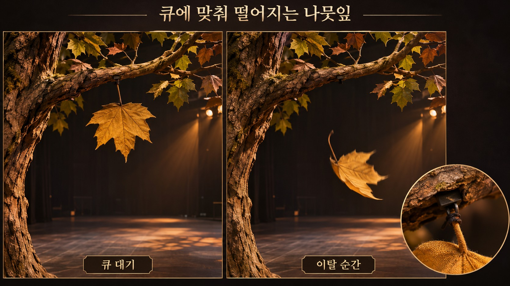
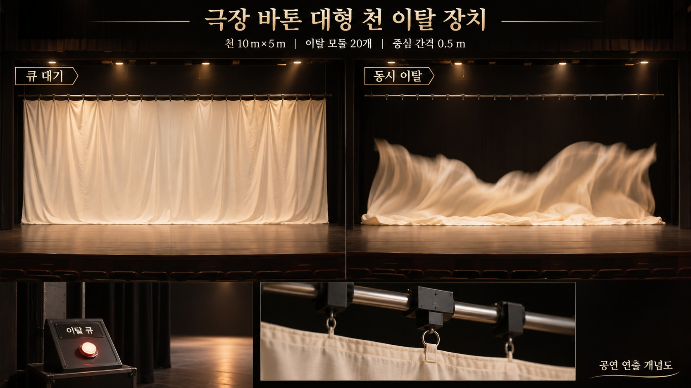

# 아두이노 UNO로 전동 래치 풀기와 잠김 상태 확인

21스테이지아트 · formakers | 2026년 11월 21일 제작 실험

SELECT를 누르면 릴레이가 0.5초 동안 래치에 12V를 공급합니다. LCD 첫 줄은 걸쇠의 상태 접점을 읽어 LOCKED 또는 UNLOCKED를 표시합니다. 고리를 손으로 다시 끼웠을 때 표시가 바뀌는 것도 확인할 수 있습니다.

[한글 주석이 있는 아두이노 전체 코드](UnoLatchPanel/UnoLatchPanel.ino)

## 부품과 배선

UNO 위에 스크류 실드를 끼우고, 그 위에 16×2 LCD 키패드 실드를 꽂습니다. 스크류 단자에서 아래 신호와 전원을 꺼냅니다. 이 기록은 HIGH 입력으로 켜지는 5V 릴레이 모듈과 외부 12V DC 래치 한 개를 기준으로 합니다.

| 출발 | 도착 | 역할 |
|---|---|---|
| UNO A1 | 릴레이 S 또는 IN | 해제 명령 |
| UNO 5V / GND | 릴레이 ＋ / − | 릴레이 모듈 전원 |
| 외부 전원 +12V | 릴레이 COM | 래치 전원 입력 |
| 릴레이 NO | 래치 구동 ＋ | 릴레이가 켜진 동안 공급 |
| 래치 구동 − | 외부 전원 − | 전류 복귀 |
| 래치 노란 상태선 | UNO D2 | 이 실험의 잠김 감지 |
| 래치 파란 상태 기준선 | UNO GND | 상태 접점 기준 |

NC는 비워 둡니다. 실드 내부에서 키패드는 A0, LCD의 RS/E는 D8/D9, DB4~DB7은 D4~D7을 사용합니다. 다른 모델은 선 색이 같아도 출력 방식이 다를 수 있습니다. D2에는 12V를 인가하지 마세요. 이 코드는 잠기면 GND와 이어지고 풀리면 열리는 접점을 가정합니다.

## 업로드와 재현

1. Arduino IDE에서 UnoLatchPanel 폴더의 같은 이름 .ino 파일을 엽니다. 보드는 Arduino Uno, 포트는 연결한 UNO를 선택합니다. LiquidCrystal 라이브러리가 필요합니다.
2. 스케치를 업로드하고 고리를 끼워 첫 줄의 LOCKED를 확인합니다.
3. 키패드에서 손을 뗐다가 SELECT를 한 번 누릅니다. 둘째 줄에 Releasing...이 표시되고 A1이 500ms 동안 HIGH가 됩니다. 계속 누르고 있어도 해제 명령은 한 번만 나갑니다.
4. 펄스가 끝나면 D2를 다시 읽습니다. 걸쇠가 풀렸으면 UNLOCKED가 표시됩니다. 다시 끼웠을 때 LOCKED로 돌아오는지 확인합니다.

SELECT 판정 범위는 A0의 600~900, 버튼 해제는 1000 초과입니다. 실드마다 실측값이 다를 수 있습니다. D2는 INPUT_PULLUP이므로 상태선이 빠져도 UNLOCKED로 읽힙니다. 이 표시는 천이나 소품의 낙하 완료를 검출하지 않습니다.

## 이미지 자료

사진형 그림은 부품 배치와 연출을 설명하는 개념 이미지입니다. 특히 결선 예시의 오른쪽 전원선 경로와 UNO 확대 핀 배열은 실제 배선과 다릅니다. 결선할 때는 위 단자표와 실물 단자명을 사용하세요.

| 시스템과 조립 | 사진형 결선 예시 |
|---|---|
| [시스템 개요](images/system.jpg) · [조립 구성](images/assembly.jpg) | [UNO · 릴레이 · 래치 배치](images/wiring-concept.jpg) |

### 무대 응용 구상

천 구상은 폭 10m × 높이 5m, 모듈 20개, 중심 간격 50cm입니다. 양 끝 고리 사이 거리는 9.5m입니다. 오늘 테스트한 스케치는 단일 채널용입니다. 여러 래치를 한 채널로 묶으면 같은 명령을 받으며, 순차 이탈에는 독립 제어 채널이 필요합니다. 여러 개를 동시에 구동할 수 있는 수량은 전원과 릴레이의 DC 부하 정격, 래치 작동 전류에 따라 달라집니다. 공연장 상부 설치의 하중 및 체결 검증은 이 단일 래치 실험의 범위 밖입니다.
